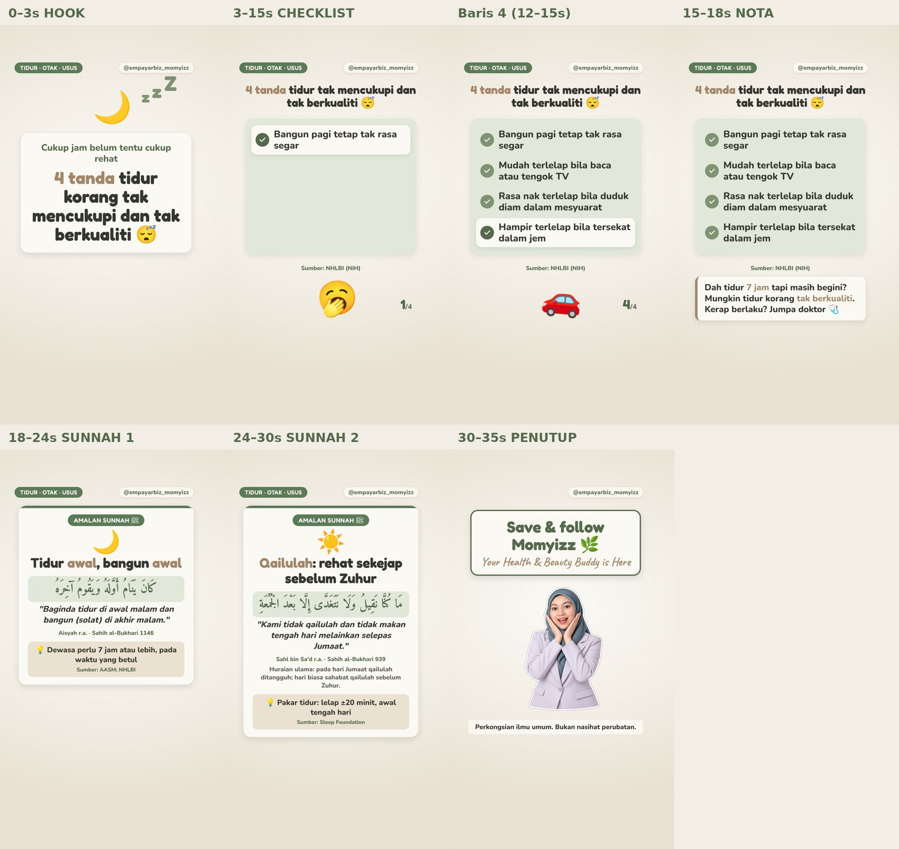

# Storyboard — Hari 8 · 4 tanda tidur tak mencukupi dan tak berkualiti + amalan sunnah (35 s)

Status: **STORYBOARD, menunggu kelulusan pengguna.** Video belum dirender.
Fail babak: `VIDEO_3D/hari08-tanda-tidur.html` · Gambar bingkai: `hari08-tanda-tidur.jpg`
Format 1080×1920, 30 fps, tiada muzik dalam fail. Sticker: `20-blazer-terkejut-pipi`.
Tanda nama **@empayarbiz_momyizz** penjuru kanan atas sepanjang video. Label pilar "TIDUR · OTAK · USUS" 0–30 s.

| # | Masa | Komponen | Teks atas skrin | Visual / animasi |
|---|---|---|---|---|
| 1 | 0–3s | HOOK | (kecil) Cukup jam belum tentu cukup rehat · **4 tanda** tidur korang tak mencukupi dan tak berkualiti 😴 | Kotak Kertas pop; bulan 🌙 terapung, "zzz" naik |
| 2 | 3–6s | CHECKLIST baris 1 | ✓ Bangun pagi tetap tak rasa segar | Tajuk kecil "4 tanda tidur tak mencukupi dan tak berkualiti 😴" di atas, panel Sage masuk; baris luncur dari kiri; ikon 🥱; kaunter 1/4 |
| 3 | 6–9s | CHECKLIST baris 2 | ✓ Mudah terlelap bila baca atau tengok TV | Ikon 📺; kaunter 2/4; baris aktif berlatar Kertas |
| 4 | 9–12s | CHECKLIST baris 3 | ✓ Rasa nak terlelap bila duduk diam dalam mesyuarat | Ikon 💼; kaunter 3/4 |
| 5 | 12–15s | CHECKLIST baris 4 | ✓ Hampir terlelap bila tersekat dalam jem | Ikon 🚗; kaunter 4/4 |
| — | 3–18s | SUMBER | Sumber: NHLBI (NIH) | Teks kecil bawah panel |
| 6 | 15–18s | NOTA | Dah tidur **7 jam** tapi masih begini? Mungkin tidur korang **tak berkualiti**. Kerap berlaku? Jumpa doktor 🩺 | Kad Kertas, jalur kiri Kayu, naik dari bawah; checklist kekal |
| 7 | 18–24s | KAD SUNNAH 1 🌙 | AMALAN SUNNAH ﷺ · **Tidur awal, bangun awal** · كَانَ يَنَامُ أَوَّلَهُ وَيَقُومُ آخِرَهُ · "Baginda tidur di awal malam dan bangun (solat) di akhir malam." · Aisyah r.a. · Sahih al-Bukhari 1146 · 💡 Dewasa perlu 7 jam atau lebih, pada waktu yang betul (AASM; NHLBI) | Kad Kertas jalur Sage, naik dari bawah |
| 8 | 24–30s | KAD SUNNAH 2 ☀️ | AMALAN SUNNAH ﷺ · **Qailulah: rehat sekejap sebelum Zuhur** · مَا كُنَّا نَقِيلُ وَلَا نَتَغَدَّى إِلَّا بَعْدَ الْجُمُعَةِ · "Kami tidak qailulah dan tidak makan tengah hari melainkan selepas Jumaat." · Sahl bin Sa'd r.a. · Sahih al-Bukhari 939 · Huraian ulama: pada hari Jumaat qailulah ditangguh; hari biasa sahabat qailulah sebelum Zuhur. · 💡 Pakar tidur: lelap ±20 minit, awal tengah hari (Sleep Foundation) | Sama seperti kad 1 |
| 9 | 30–35s | PENUTUP + PENAFIAN | Save & follow Momyizz 🌿 / Your Health & Beauty Buddy is Here · Perkongsian ilmu umum. Bukan nasihat perubatan. | Kotak bersempadan Sage turun; sticker pop + goyang; penafian 5 s |

## Semakan fakta
| Fakta | Sumber | Status |
|---|---|---|
| 4 tanda (rasa nak terlelap bila duduk diam; bangun tak segar) | NHLBI, *Sleep Deprivation – Health Effects*: "You might be sleep deficient if you often feel like you could doze off while…"; "You may not feel refreshed and alert when you wake up." | 🟢 Disahkan (dibaca 20 Nov 2026) |
| "Tak mencukupi dan tak berkualiti"; "pada waktu yang betul" | NHLBI, *What Are Sleep Deprivation and Deficiency?*: sleep deficiency = tak cukup tidur, "You sleep at the wrong time of day", "You don't sleep well or get all the different types of sleep your body needs", atau gangguan tidur | 🟢 Disahkan (dibaca 20 Nov 2026) |
| Dewasa 7 jam+ | AASM/SRS (2015), sudah dalam `KALENDAR_PENULISAN/PODCAST_SEMAKAN.md` | 🟢 |
| Nap ±20 minit, awal tengah hari | Sleep Foundation, *Napping*: "the best nap length for adults is about 20 minutes and no longer than 30 minutes"; "the best time to take a nap is either just before or during the post-lunch dip" | 🟢 Disahkan (dibaca 20 Nov 2026) |
| Hadis Aisyah r.a. | Sahih al-Bukhari 1146 (Kitab Tahajjud). Matan Arab disemak dengan salinan terbuka Sahih al-Bukhari | 🟢 Sahih |
| Hadis Sahl bin Sa'd r.a. | Sahih al-Bukhari 939 (Kitab Jumaat). Matan Arab disemak. Riwayat sama: Bukhari 941 | 🟢 Sahih |
| "Hari biasa qailulah sebelum Zuhur" | Huraian ulama terhadap hadis Bukhari 939 / 941. Waktu qailulah (sebelum atau selepas Zuhur) ada perbezaan pandangan | 🟡 **Minta ustaz/ustazah semak** |

Tidak digunakan: hadis "Qailulah lah kamu, kerana syaitan tidak qailulah" (status diperselisihkan) dan dakwaan "terlelap dalam 5 minit = sangat kurang tidur" (sumber NINDS tidak dapat disahkan).

## Perlu buat selepas lulus
- Kemas kini babak dalam `KALENDAR_PENULISAN/kalendar_data.py` (`MG_TREND` T1) dan jalankan `bina.py` supaya `MINGGU_2.md` sama dengan video.
- Render: `BITRATE=8M MAXRATE=10M node VIDEO_3D/render.js hari08-tanda-tidur.html 35 VIDEO_3D/hari08-tanda-tidur.mp4`
- Caption cadangan: "Berapa tanda korang ada? 👇 Tiada tanda pun tak semestinya cukup tidur: sasaran dewasa 7 jam+ (AASM). Sunnah pun ajar tidur awal & qailulah sekejap 🌙☀️\n\nSumber: NHLBI; AASM; Sleep Foundation; Sahih al-Bukhari 939, 1146.\nPerkongsian ilmu umum. Bukan nasihat perubatan.\n\n#Momyizz #Tidur #Qailulah #IbuBekerja"
